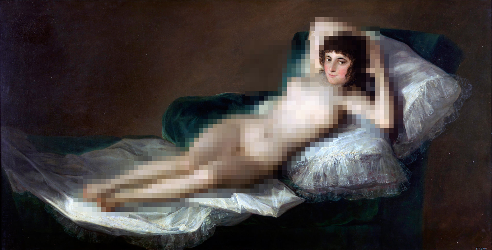
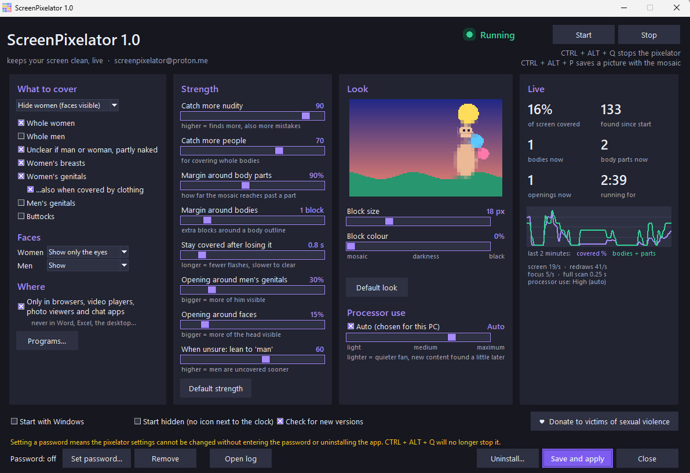

# ScreenPixelator 1.0

ScreenPixelator puts a mosaic over nudity on your Windows screen, live, in any program you choose: browsers, video players, photo viewers, chat apps. It runs quietly in the background, follows moving video and scrolling pages, and leaves the rest of your screen alone.

Everything happens on your own computer. No screen images, settings or statistics are ever sent anywhere.

*Francisco Goya, La maja desnuda (c. 1797–1800), Museo del Prado. Public domain, via Wikimedia Commons. Covered by ScreenPixelator with "Hide women (faces visible)".*

---

## What it can do

- **Cover nudity live** on the screen: women's breasts and genitals (optionally also when covered by clothing), men's genitals and buttocks, each switchable.
- **Cover whole bodies**: whole women, whole men, or people whose gender is unclear and who are partly naked. Faces can stay visible.
- **Faces**, separately for women and men: show, hide, show only the eyes, or hide only the eyes.
- **Follow movement**: the mosaic moves with video, scrolling and dragged windows, and predicts the movement a little ahead.
- **Only where you want it**: by default only inside browsers, video players, photo viewers and chat apps, never in Word, Excel, File Explorer or on the desktop. The list of programs can be edited.
- **Look**: block size, and block colour from mosaic (the colours of the picture) to black.
- **Strength**: sliders for how eagerly it detects nudity and people, margins around body parts and bodies, how long something stays covered, and the size of see-through openings.
- **Processor use**: from *Light* (quiet fan, older PCs) to *Maximum*, or *Auto*.
- **Settings window** with a live preview, live numbers (how much is covered, what was found) and a graph.
- **Tray icon** next to the clock (can be hidden), **start with Windows** (optional), and an optional **password** for the settings.

## What it is not

- **Not a parental control or child protection tool.** Anyone who knows a little about computers can stop it (Task Manager), delete its settings file, or uninstall it. The password only prevents casual changes.
- **Not perfect.** It is an automatic detector, so it makes mistakes in both directions:
  - it can **miss** nudity, especially very small, dark, blurred, partly hidden, unusual or drawn/cartoon images, and fast changes in video can be visible for a moment (typically 0.2 to 1 second) before they are covered;
  - it can **cover things that are not nudity** (false alarms), such as skin-coloured objects, close-ups of arms or faces, or a clothed person taken for a woman.
- **Gender is guessed.** Whether someone is treated as a man or a woman is an automatic guess from what is visible, and it will sometimes be wrong. When unsure, faces stay visible.
- **Screenshots and screen recordings are not covered.** The mosaic is drawn on top of the screen and is deliberately left out of screen captures (otherwise it would see its own mosaic). Screenshots, screen sharing and recordings show the screen without the mosaic. To save a picture with the mosaic, press CTRL + ALT + P.
- **Main screen only.** On a PC with several screens, only the main screen is covered.
- **Windows only**, and only programs that show their picture in a normal window; some full-screen games and protected video may not be covered.

## What it needs

- Windows 10 (version 2004 or newer) or Windows 11, 64-bit, on an Intel or AMD processor.
- About 600 MB of disk space (Python and its packages included).
- An internet connection during installation only.
- A reasonably modern processor. It works on older PCs with the *Light* processor setting, but finds new content more slowly there. Expect the fan to run more on *High* and *Maximum*.

## Installing

1. Download the latest release from the **Releases** page.
2. Unzip it and double-click **Install.bat** (or `ScreenPixelator-Setup.exe` in the .exe version).
3. The installer downloads and installs Python 3.13 and the needed packages if they are missing, puts the program in `%LOCALAPPDATA%\ScreenPixelator`, adds **Screen Pixelator Settings** to the Start menu and desktop, and starts it.

**Windows warning?** The program is new and not yet code-signed, so Windows SmartScreen may say "Windows protected your PC" (click *More info* → *Run anyway*), and some antivirus programs may wrongly flag the .exe installer (for example as "Trojan:Win32/Bearfoos"). This is a false alarm caused by how installers work (an unknown program that unpacks files and starts PowerShell). The script version (Install.bat) is less likely to be flagged. All source code, including the installer, is in this repository for anyone to check.

**Updating:** when a new version is out, the settings window shows a *New version* button that opens its download page. Run the installer of the new version; your settings are kept.

**Uninstalling:** Windows Settings → Apps → Installed apps → ScreenPixelator 1.0 → Uninstall (works without the password), or the *Uninstall* button in the settings window. Python and its packages stay installed.

**Forgot the password?** Delete `settings.json` in `%LOCALAPPDATA%\ScreenPixelator`. All settings go back to the defaults.

## Using it

- Open **Screen Pixelator Settings** from the Start menu, the desktop or the tray icon.
- Change what you like and click **Save and apply**. The pixelator restarts with the new settings in a few seconds.
- **CTRL + ALT + Q** stops the pixelator (switched off while a password is set).
- **CTRL + ALT + P** (or *Save picture with mosaic* in the tray icon's menu) saves a picture of the screen with the mosaic in `Pictures\ScreenPixelator` (normal screenshot tools can't see the mosaic, see below).

## Privacy

ScreenPixelator looks at the screen only in memory, on your own computer, and never stores or sends pictures of it. Its only network activity:

- during installation: Python from python.org and packages from PyPI;
- when the settings window opens: it asks GitHub whether a newer version exists (nothing about you or your screen is sent; switch off with *Check for new versions*);
- when you click a donation button: the organisation's website opens in your browser.

## Donations

ScreenPixelator is free. If you would like to give something, please give it to people who help victims of sexual violence. The *Donate to victims of sexual violence* button in the settings window links to:

- [Mukwege Foundation](https://www.mukwegefoundation.org/donate/): care and support for survivors of sexual violence in war zones, worldwide
- [SOS Viol](https://www.sosviol.be): help line and support for rape victims in Belgium
- [Child Focus](https://childfocus.be): helps sexually exploited and missing children in Belgium

## Feedback and bugs

Please use **Issues** for bugs (what you did, what you expected, what happened, Windows version, and the *Open log* text if there is an error) and **Discussions** for questions and ideas. Never post screenshots that show nudity or personal information.

Contact: screenpixelator@proton.me

## Credits

ScreenPixelator is built on the work of others:

- **[NudeNet](https://github.com/notAI-tech/NudeNet)** by notAI-tech: the nudity detection model (MIT License)
- **[Ultralytics YOLO11](https://github.com/ultralytics/ultralytics)**: the person outline model `yolo11n-seg` (AGPL-3.0 License)
- **[ONNX Runtime](https://github.com/microsoft/onnxruntime)** by Microsoft: runs the models (MIT License)
- **[OpenCV](https://opencv.org)**: image processing and movement tracking (Apache License 2.0)
- **[NumPy](https://numpy.org)**: number crunching (BSD License)
- **[DXcam](https://github.com/ra1nty/DXcam)** and **[python-mss](https://github.com/BoboTiG/python-mss)**: fast screen capture (MIT License)
- **[Python](https://www.python.org)** and **Tkinter**: the program and its settings window (Python Software Foundation License)
- **[Zig](https://ziglang.org)**: used to build the Windows setup program (MIT License)
- The program was written together with **Claude**, an AI assistant made by [Anthropic](https://www.anthropic.com).

## License

ScreenPixelator is free software under the **GNU Affero General Public License v3.0** (AGPL-3.0); see `LICENSE`. You may use, share and change it, as long as anything you distribute based on it is also released under the AGPL-3.0 with its source code. This license is required because the person model (Ultralytics YOLO11) is AGPL-3.0.

The software is provided "as is", without any warranty. Use it at your own discretion.

## Version history

- **1.0**: first public version.
